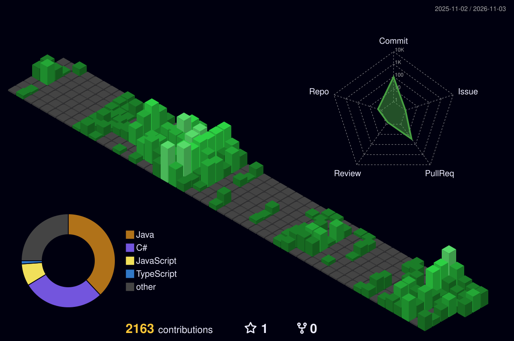



# Hi, I'm Hai 👋

### Backend Developer · Java & Node.js

*Turning practical ideas into clear APIs and maintainable applications.*

---

## 👨‍💻 About me

I'm **Hai**, a developer focused on **backend development** with Java, Spring Boot, Node.js, and Express. My interests include API design, relational data modeling, and the tools that support application delivery.

I value **readable code, clear communication, and practical solutions**. My goal is to build software that addresses real business needs and is straightforward for a team to maintain and extend.

- 🔧 **Focus:** Backend services, APIs, and relational databases.
- 🌱 **Growing in:** Application architecture, caching, and delivery automation.
- 🤝 **Let's talk:** Recruitment, technical discussions, and potential collaboration.

## 🛠️ Technical toolkit

### Languages & runtime

### Backend frameworks

### Databases & caching

### Tools & delivery

## 🎯 Engineering priorities

| Priority | What I aim for |
| :--- | :--- |
| **Business understanding** | Start with the problem, requirements, and expected behavior. |
| **Maintainable code** | Use clear naming and focused responsibilities. |
| **Reliable data** | Consider relationships, constraints, and consistency. |
| **Clear APIs** | Make interfaces easy to understand, document, and verify. |
| **Team collaboration** | Communicate decisions and tradeoffs to support review and handover. |

## 📊 GitHub activity

 

🐍 Explore my contribution visualizations

 

 

---

### 💬 Let's build something useful

Interested in my work or discussing an opportunity? 
Share the role or project context — I'd be happy to connect.

**[HaiDD.CE192014@gmail.com](mailto:HaiDD.CE192014@gmail.com)**

